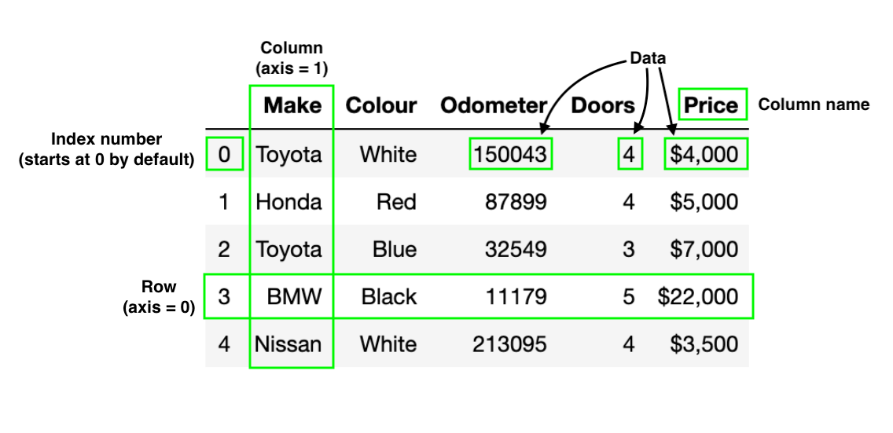

# Importing Pandas

The most common way (and method to use) is to import pandas as the abbreviation `pd` (e.g., `pandas` => `pd`)

If we see the letter `pd` used anywhere in machine learning or data science, it's probably referring to the pandas library

```python
import pandas as pd

# print the version
print(f"pandas version: {pd.__version__}")
```

# Datatypes

pandas has two main datatypes, `Series` and `Dataframe`

- `pandas.Series`: a one-dimensional column of data
- `pandas.Dataframe`: most common, a two dimensional table of data with rows and columns

We can create a `Series` using `pd.Series()` and passing it a Python list.

```python
# Creating a series of car types
cars = pd.Series(["BMW", "Toyota", "Honda"])
cars

# Creating a series of colours
colours = pd.Series(["Blue", "Red", "White"])
colours
```

Similarly, we can create a `Dataframe` by using `pd.Dataframe()` and passing it a Python dictionary.

Let's use our above two `Series` as the value.

```python
# Creating a Dataframe of cars and colours
car_data = pd.Dataframe({"Car type": cars, "Colours": colours})
car_data
```

We can see the keys of the dictionary became the column heading (text in bold) and the values of the two `Series`'s become the values in the Dataframe.

Its important to note, many different types of data could go into the `Dataframe`

Here we've used only text but we could use floats, integers, dates and more.

# Importing data:

Creating `Series` and `Dataframe`'s from scratch is nice but what we will usually be doing is importing data in the form of a .csv (comma separated value), spreadsheet file or something similar such as an SQL database.

pandas allows for easy importing of data like this through functions such as `pd.read_csv()` and `pd.read_excel()`

```python
# Importing car sales data
car_sales = pd.read_csv("path_to_your_dataset/car-sales.csv") # takes a filename as string as input

# Option 2: Read directly from a URL/Google sheets
# If you are reading from Github, be sure to use the "raw" link (original link: https://github.com/mrdbourke/zero-to-mastery-ml/blob/master/data/car-sales.csv)
car_sales = pd.read_csv("https:/raw.githubusercontent.com/mrdbourke/zero-to-mastery-ml/master/data/car-sales.csv")
car_sales
```

Another common practice we will see is data being imported to `Dataframe` called `df` (short for `Dataframe`)

```python
# Import the car sales data and save it to df

# Option 1: Read from a CSV file (stored on our local computer)
df = pd.read_csv("../data/car-sales.csv")

# Option 2: Read directly from a URL/Google Sheets (if the file is hosted online)
df = pd.read_csv("https://raw.githubusercontent.com/mrdbourke/zero-to-mastery-ml/master/data/car-sales.csv")
df
```

# Anatomy of a Dataframe



# Exporting data

pandas allows us to export `Dataframe`'s to `.csv` format using `to_csv()` or spreadsheet format using `to_excel()`

```python
# Export the car sales DataFrame to csv
car_sales.to_csv("../data/exported-car-sales.csv")
```
